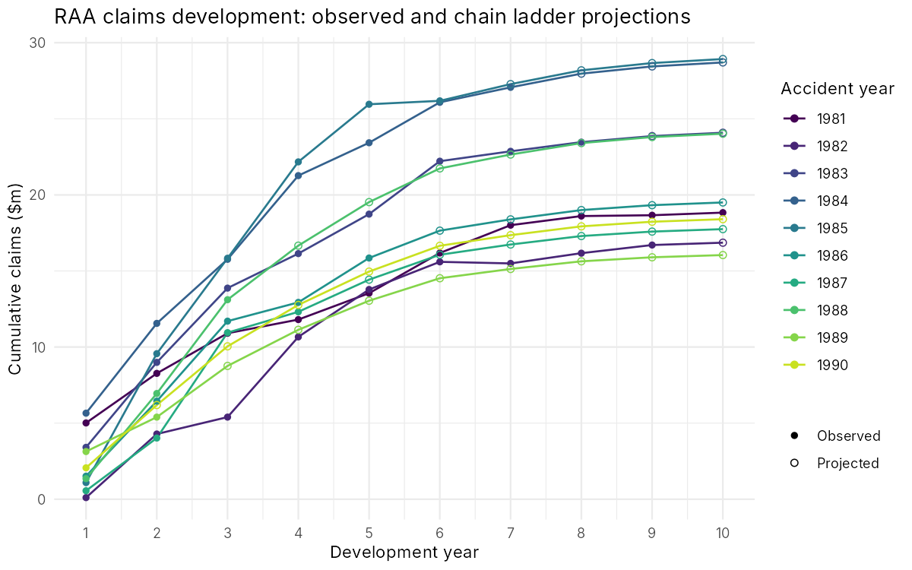
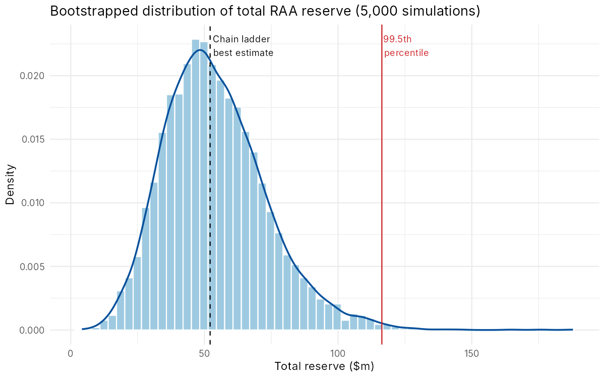
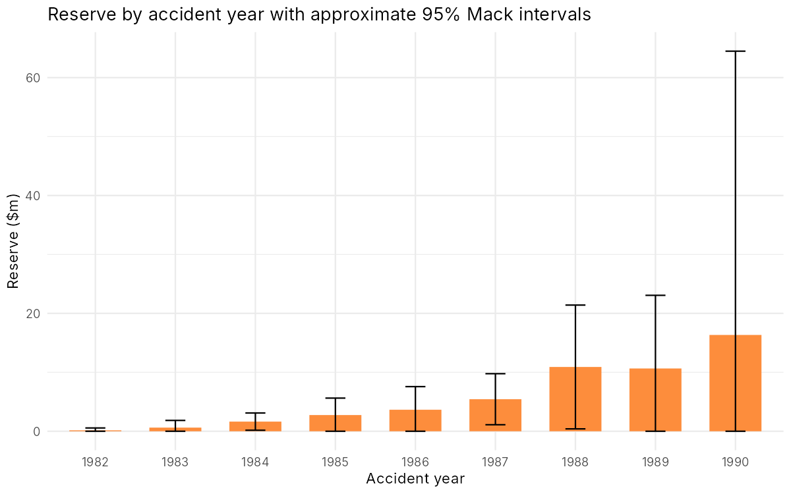
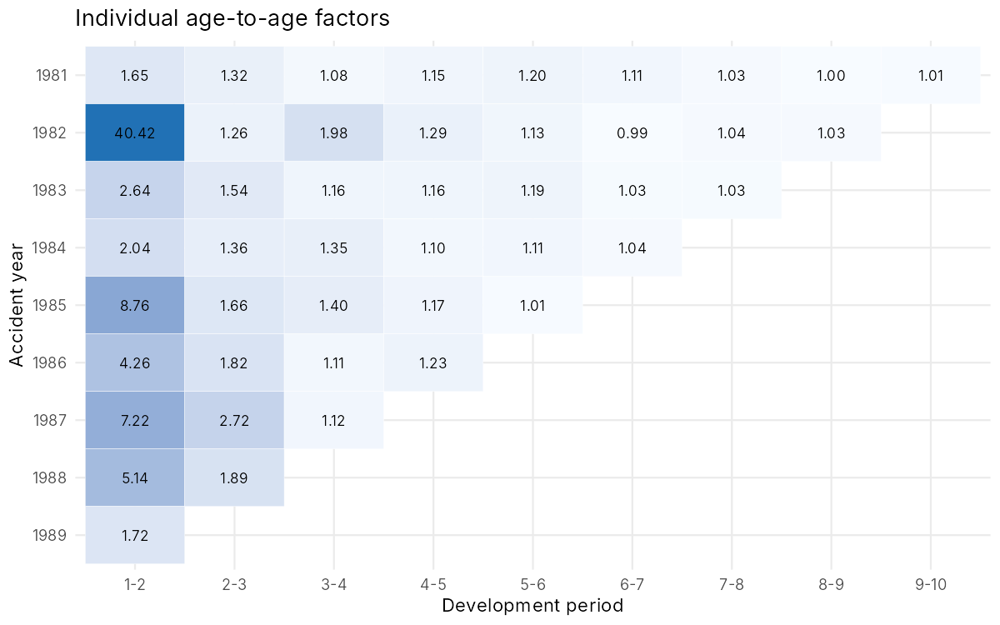

# Insurance Claims Reserving with the Chain Ladder Method

Estimating how much an insurer needs to hold back for claims that have already happened but haven't fully been reported or paid. The project uses the classic RAA general liability triangle and goes from a hand-built chain ladder to Mack standard errors and a bootstrapped reserve distribution.

**Tools:** R · ChainLadder · ggplot2

## The problem

Liability claims take years to settle. At the end of 1990 an insurer knows what has been reported so far for each accident year (1981–1990), but the 1990 claims are only one year into their development. The question is: what will these claims finally cost, and how much more money needs to be set aside?

## Data

`RAA` from the R `ChainLadder` package: cumulative incurred claims ($000s) from the Reinsurance Association of America, accident years 1981–1990, 10 development years. This is the triangle Thomas Mack used in his 1993 paper, so the results can be checked against the literature.

## Method

1. **Age-to-age factors.** For each development period, compare how much cumulative claims grew from one year to the next.
2. **Volume-weighted development factors.** Combine those into one factor per period, weighting by claim size: f_j = ΣC(i,j+1) / ΣC(i,j). This is coded by hand and checked against the package.
3. **Projection.** Multiply the latest diagonal through the remaining factors to fill in the lower triangle and get ultimate claims. Reserve = ultimate − latest.
4. **Mack model.** Adds a variance assumption to the chain ladder, giving a standard error for each accident year and in total, with no distribution assumed.
5. **ODP bootstrap (5,000 simulations).** Resamples residuals from an over-dispersed Poisson model to get a full distribution of the total reserve, including percentiles like the 99.5th used for Solvency II capital.

## Results

| Accident year | Latest | Development factor to ultimate | Ultimate | Reserve | Mack SE |
|---|---:|---:|---:|---:|---:|
| 1981 | 18,834 | 1.000 | 18,834 | 0 | 0 |
| 1982 | 16,704 | 1.009 | 16,858 | 154 | 206 |
| 1983 | 23,466 | 1.026 | 24,083 | 617 | 623 |
| 1984 | 27,067 | 1.060 | 28,703 | 1,636 | 747 |
| 1985 | 26,180 | 1.105 | 28,927 | 2,747 | 1,469 |
| 1986 | 15,852 | 1.230 | 19,501 | 3,649 | 2,002 |
| 1987 | 12,314 | 1.441 | 17,749 | 5,435 | 2,209 |
| 1988 | 13,112 | 1.832 | 24,019 | 10,907 | 5,358 |
| 1989 | 5,395 | 2.974 | 16,045 | 10,650 | 6,333 |
| 1990 | 2,063 | 8.920 | 18,402 | 16,339 | 24,566 |
| **Total** | **160,987** | | **213,121** | **52,134** | **26,909** |

All figures in $000s.

- **Best estimate reserve: $52.1m** on top of the $161.0m already reported.
- **Mack total standard error: $26.9m** (coefficient of variation 52%). Uncertainty is high because this is long-tailed liability business and the triangle is small.
- **Bootstrap:** mean $54.2m, 75th percentile $65.5m, 95th percentile $88.6m, 99.5th percentile $116.4m. The distribution is right-skewed, so a symmetric "estimate ± 2 SE" understates the bad tail.
- **1990 drives the uncertainty.** It holds 31% of the reserve but its standard error is larger than the reserve itself. Its estimate rests on a single observed value multiplied by a factor of 8.9.






## Limitations and what I'd do next

- **The 1–2 factor is unstable.** Individual factors range from 1.65 to 40.4 (1982 started tiny). The volume-weighted average dampens this, but the 1990 estimate is still very sensitive to it. A **Bornhuetter–Ferguson** method, which blends in a prior loss ratio for immature years, would be more robust for 1990.
- **No tail factor.** The chain ladder assumes everything is settled by development year 10. Liability claims can run longer, so a fitted tail factor would add to the reserve.
- **Assumes the past repeats.** Changes in claims handling, inflation or legal environment break the chain ladder's core assumption. With paid and incurred data, a Munich chain ladder comparison would be a useful check.

## How to run

```r
install.packages(c("ChainLadder", "ggplot2"))
source("R/01_chain_ladder.R")         # deterministic chain ladder, tables, plots
source("R/02_mack_and_bootstrap.R")   # Mack SEs, bootstrap distribution
```

Run from the project root. Outputs are written to `output/tables` and `output/figures`.

## References

- Mack, T. (1993). Distribution-free calculation of the standard error of chain ladder reserve estimates. *ASTIN Bulletin* 23(2).
- England, P. & Verrall, R. (2002). Stochastic claims reserving in general insurance. *British Actuarial Journal* 8(3).
- Gesmann, M. et al. ChainLadder R package.
