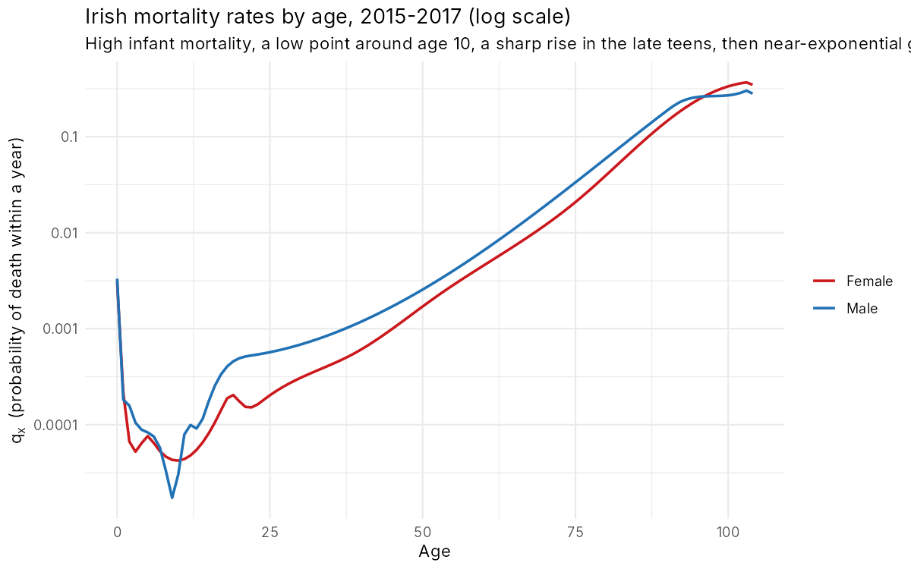
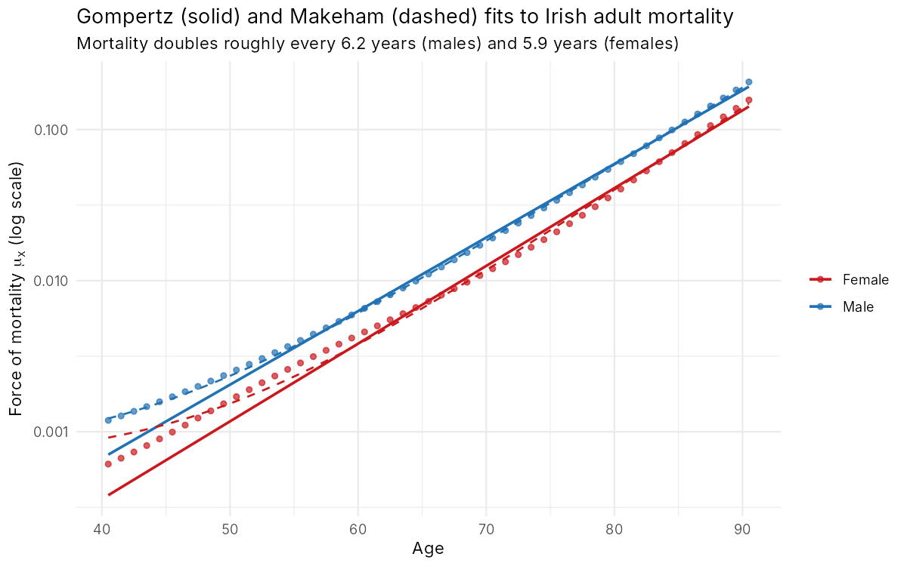
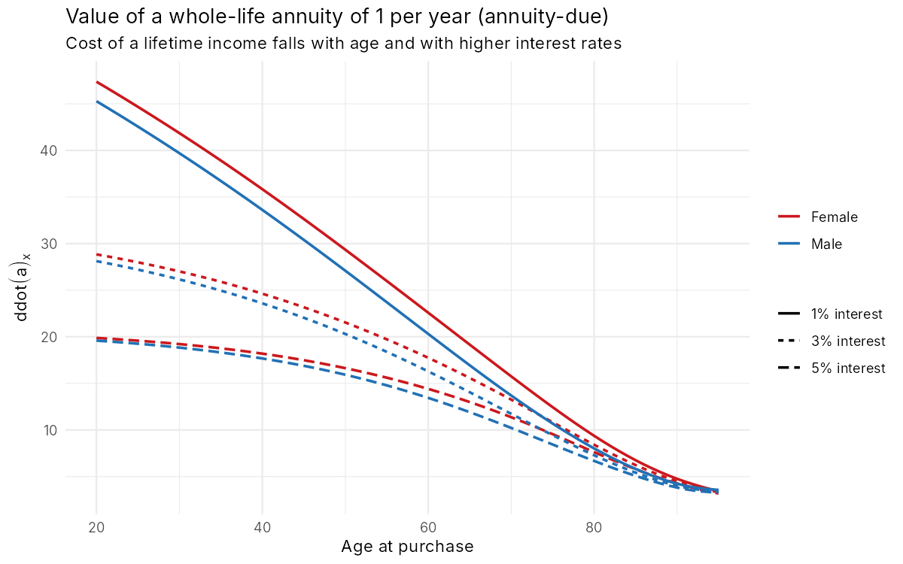

# Irish Life Expectancy and Mortality Analysis

Life actuarial work on official Irish data: building full life tables from the CSO's Irish Life Tables No. 17 (2015–2017), fitting the Gompertz and Makeham laws of mortality, and pricing life insurance and pensions from first principles.

**Tools:** R · ggplot2 · maximum likelihood

## The questions

- How long can Irish men and women expect to live, and how does the gap change with age?
- How well do classical mortality laws describe Irish mortality?
- What does that mortality imply for the price of life cover and the cost of a pension?

## Data

The CSO's most recent official life table, Irish Life Tables No. 17 (2015–2017). It gives single-year probabilities of death q(x) by sex for ages 0–105. See [`data/README.md`](data/README.md) for the source and checks.

## Method

1. **Life table construction** (`01_life_table.R`). Build l(x), d(x), L(x), T(x) and e(x) from q(x), assuming deaths are uniformly spread over each year of age. Infants are the exception: their deaths are concentrated in the first weeks of life. The script checks that the computed life expectancy at birth matches the CSO's published figures.
2. **Mortality laws** (`02_gompertz.R`). Treat deaths d(x) over person-years L(x) as Poisson data and fit by maximum likelihood over ages 40–90:
   - **Gompertz:** μ(x) = B·cˣ. Mortality grows exponentially with age.
   - **Makeham:** μ(x) = A + B·cˣ. Adds a constant, age-independent risk (accidents, background causes).
3. **Life insurance values** (`03_life_insurance_values.R`). Expected present values of annuities and assurances, net premiums for term life cover, the single-premium cost of a pension, and sensitivity to interest rates and future mortality improvement. The script checks that the identity A(x) + d·ä(x) = 1 holds exactly.

## Results

**Life expectancy** (years remaining)

| Age | Male | Female | Gap |
|---:|---:|---:|---:|
| 0 | 79.6 | 83.4 | 3.8 |
| 20 | 60.1 | 63.8 | 3.7 |
| 40 | 40.8 | 44.1 | 3.3 |
| 65 | 18.3 | 21.0 | 2.7 |
| 80 | 7.9 | 9.4 | 1.5 |

- 89% of newborn boys and 93% of girls reach 65. Of those alive at 65, 45% of men and 59% of women reach 85.
- The most common age at death is 86 for men and 89 for women. The median is 82 and 86.
- Male mortality jumps sharply in the late teens (the **accident hump**: road deaths, suicide, risk-taking). In the early twenties men are about 3.5× as likely to die as women.

**Mortality laws**

| | Gompertz c | Mortality doubles every | Makeham A | Log RMSE: Gompertz | Log RMSE: Makeham |
|---|---:|---:|---:|---:|---:|
| Male | 1.119 | 6.2 years | 0.00069 | 0.169 | **0.025** |
| Female | 1.126 | 5.9 years | 0.00065 | 0.215 | 0.128 |

- Adult mortality roughly **doubles every six years**, which is Gompertz's law.
- Pure Gompertz underestimates mortality in the 40s by roughly 40–65%. The Makeham constant (about 7 deaths per 10,000 per year at every age) fixes this almost completely for men.
- Women's mortality has a different shape. It rises faster than exponential through the 40s and 50s, which no two- or three-parameter law captures well. That's why insurers graduate mortality with more flexible models.

**Pricing** (3% interest, Irish period life table, no expenses)

| | Male | Female |
|---|---:|---:|
| 20-year term assurance, €250,000, bought at 30: annual net premium | €291 | €158 |
| Single premium at 65 for a €10,000 a year lifetime pension | €140,473 | €155,797 |
| Same pension, allowing for 1.5% a year mortality improvement | €149,017 (+6.1%) | €164,723 (+5.7%) |

- **Interest rates matter as much as mortality.** Moving from 5% to 1% interest raises the cost of a male pension from €119k to €169k (+42%). Low rates are why annuities became so expensive in the 2010s.
- **Longevity risk:** a period table assumes no future improvement. Allowing for 1.5% a year improvement adds about 6% to the pension's cost. Underestimating improvement is one of the biggest risks for pension schemes and annuity writers.
- Women pay about half as much for term cover but about 11% more for a pension, because they live longer. **Since the 2011 Test-Achats ruling, EU insurers can't charge different prices by sex**, so real premiums are unisex blends of these figures.








## Limitations and what I'd do next

- **Period vs cohort.** These tables describe mortality in 2015–2017. Someone born today will probably live longer. A **Lee–Carter** model fitted to the CSO's historical tables would project how mortality improves over time.
- **Population vs insured lives.** People who buy annuities tend to be healthier and wealthier than average, and life cover is underwritten. An insurer would adjust the population table for that selection.
- **Simplifications.** Annual payments, no expenses or profit margin, and a flat interest rate rather than a yield curve.
- **Recency.** Life Tables No. 17 is the CSO's latest official table, but it predates COVID-19.

## How to run

```r
install.packages(c("ggplot2", "scales"))
source("R/01_life_table.R")             # life tables, life expectancy, survival
source("R/02_gompertz.R")               # Gompertz and Makeham fits
source("R/03_life_insurance_values.R")  # annuities, assurances, premiums
```

Run from the project root, in order.

## References

- Central Statistics Office. *Irish Life Tables No. 17, 2015–2017*.
- Dickson, D., Hardy, M. & Waters, H. *Actuarial Mathematics for Life Contingent Risks*. Cambridge University Press.
- Gompertz, B. (1825). On the nature of the function expressive of the law of human mortality. *Phil. Trans. Royal Society*.
