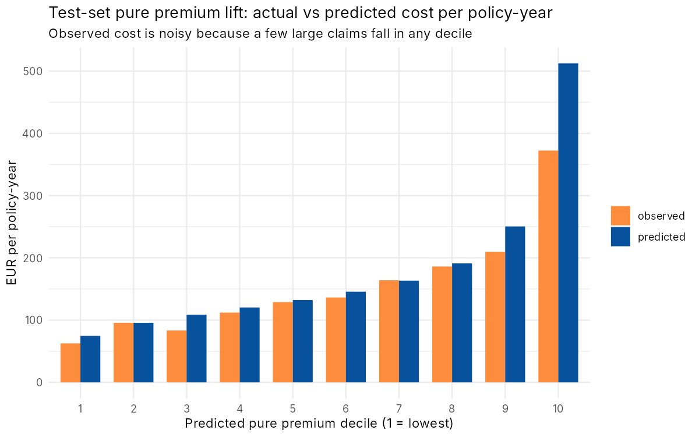

# Motor Insurance Pricing with GLMs

Pricing French motor third-party liability insurance from 678,000 real policies. A Poisson GLM predicts how often each customer claims, a Gamma GLM predicts how much each claim costs, and together they give a risk-based pure premium for every policy.

**Tools:** R · data.table · ggplot2 · GLMs (Poisson, Gamma)

## The problem

An insurer charging every driver the same price will attract the risky ones and lose the safe ones to competitors. The goal is to charge each policyholder their **expected claims cost**, the pure premium:

> pure premium = expected claim frequency × expected claim severity

## Data

`freMTPL2freq` and `freMTPL2sev` from the CASdatasets R package (Charpentier & Dutang): 677,991 French motor policies observed for up to a year, with 26,444 individual claim amounts. Rating factors include driver age, vehicle age, power, brand and fuel type, bonus-malus level, population density and region. The raw `.rda` files are included in `data/`.

Data cleaning follows the standard treatment in Noll, Salzmann & Wüthrich (2018): claim counts are capped at 4, exposure at 1 year, and bonus-malus at 150.

## Method

1. **Exploration.** One-way claim frequencies for each factor, to see shapes and choose bands for driver and vehicle age.
2. **Frequency model.** Poisson GLM with a log link and a `log(exposure)` offset, fitted on an 80% training set. A policy covering 3 months is expected to have a quarter of the claims of a full-year policy, and the offset makes the model account for that.
3. **Model selection.** A likelihood ratio test showed `Area` adds nothing once `log(Density)` is included (p = 0.13), so it was dropped. Both measure how urban the driver is.
4. **Over-dispersion.** The Pearson dispersion is 1.65, not 1, so the variance is larger than a pure Poisson allows. The confidence intervals use quasi-Poisson standard errors so they aren't too narrow.
5. **Large claims.** The largest claim is €4.1m against a median of €1,172. Claims are capped at the 99.5th percentile (€34,400), and the 25.3% of cost above the cap is spread across all policies as a flat loading. Without that, a few huge claims would distort the severity model.
6. **Severity model.** Gamma GLM with a log link on average capped claim size, weighted by number of claims. Only factors significant under an F-test were kept: driver age, vehicle age and bonus-malus.
7. **Validation.** Poisson deviance and lift charts on the held-out 20% test set, plus a balance check of total predicted vs actual cost.

## Results

**Frequency model**

| Model | Parameters | Test Poisson deviance | Improvement |
|---|---:|---:|---:|
| Intercept only | 1 | 0.25790 | — |
| Final GLM | 56 | 0.24653 | 4.4% |

A 4.4% deviance reduction sounds small, but it's typical for claim counts: most policies have zero claims whatever their risk, so a lot of the variation is pure chance. The lift chart shows the model separates risk well. The riskiest 10% of test policies claim **5.6× as often** as the safest 10% (0.199 vs 0.035 claims per year), and predicted and observed frequencies line up across all ten deciles.

**What drives claim frequency** (multiplicative relativities):
- **Bonus-malus** is the strongest factor: each point adds 2.7%, so a driver at 100 (neutral) is expected to claim about **3.9×** as often as one at 50 (best).
- **Young drivers:** the one-way frequency for ages 18–20 is over 3× the average for ages 40–50, but in the model their relativity is only 1.1. That's because bonus-malus already captures most of it: new drivers start at 100. This is the main reason to use a multivariate model instead of one-way tables.
- **Urban density:** doubling population density raises frequency by about 5%.
- **Older vehicles** claim less: vehicles over 15 years old have a relativity of 0.68.
- **Diesel** vehicles claim more than petrol (petrol relativity 0.85), probably because diesel drivers cover more kilometres.

**Severity:** claim sizes depend much less on the rating factors. Drivers aged 18–20 have 42% larger claims and brand-new vehicles 17% larger, while density and fuel type had no significant effect.

**Pure premiums:** the portfolio average is €179 per policy-year, with 10th and 90th percentiles of €88 and €307.

| Example customer | Frequency | Severity | Pure premium |
|---|---:|---:|---:|
| Driver aged 19, new high-power car, Paris area, BM 100 | 0.391 | €3,982 | **€1,556** |
| Driver aged 45, 8-year-old diesel, rural Brittany, BM 50 | 0.060 | €2,069 | **€125** |
| Driver aged 72, 3-year-old car, mid-size town, BM 50 | 0.070 | €2,540 | **€178** |

**Balance check:** on capped claims the model reproduces total cost almost exactly on the training set (ratio 0.999) and within 3.3% on the test set (0.967). Including large claims, test-set predicted cost is 14% above actual. That's expected: a 20% sample can easily contain fewer of the rare €100k+ claims than average.







## Limitations and what I'd do next

- **The flat large-loss loading over-charges the top decile.** Spreading large losses evenly assumes everyone is equally likely to have a catastrophic claim. A separate large-claim frequency model (or a Pareto tail) would allocate that cost more accurately.
- **No interactions.** For example, the effect of vehicle power probably differs for young drivers. A gradient-boosted model (GBM) would find these automatically. Using it to propose GLM interactions keeps the final tariff explainable.
- **Bands are hand-picked.** A GAM with smooth terms for driver age and density would avoid choosing band edges by eye.
- **This is a pure premium, not a price.** A real price also needs expenses, profit margin, reinsurance and competitor or demand considerations. Under EU rules gender can't be used, and that would also apply here.

## How to run

```r
install.packages(c("data.table", "ggplot2", "scales"))
source("R/01_prepare_data.R")                # cleaning, banding, train/test split
source("R/02_frequency_model.R")             # Poisson GLM, relativities, lift chart
source("R/03_severity_and_pure_premium.R")   # Gamma GLM, pure premiums, balance check
```

Run from the project root. The full run takes a few minutes, mainly the 540k-row frequency GLM.

## References

- Charpentier, A. & Dutang, C. CASdatasets R package (freMTPL2freq, freMTPL2sev).
- Noll, A., Salzmann, R. & Wüthrich, M. (2018). Case study: French motor third-party liability claims. SSRN 3164764.
- Ohlsson, E. & Johansson, B. (2010). *Non-Life Insurance Pricing with Generalized Linear Models*. Springer.
